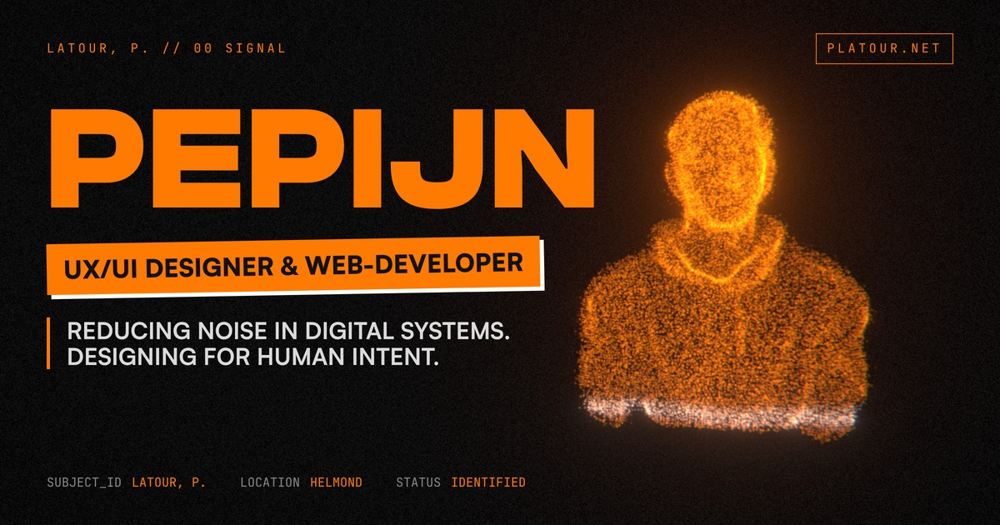

# Pepijn Latour — Portfolio

An interactive portfolio about finding clarity in digital systems. The page moves through a 3D particle story, selected design and development work, and a contact form. Visit it at [platour.net](https://platour.net).

[](https://platour.net)


## Stack

- React 19, TypeScript, Tailwind CSS 4, and Vite 8
- Three.js WebGPU particles with a WebGL fallback; the portrait uses `public/PepijnPCD.pcd`
- GSAP for scroll and chapter timing
- Cloudflare Workers with static assets; the contact form sends mail through Fastmail JMAP

## Run locally

Install [Bun](https://bun.sh/), then:

```bash
bun install --frozen-lockfile
bun dev
```

`bun run build` typechecks and builds the client and Worker. `bun run lint` runs ESLint.

## Deploy

`bun run deploy` builds and deploys the production Worker to `platour.net`. `bun run deploy:preview` creates an isolated Worker Preview for the current branch. Preview deployments need their own secrets.

The Worker uses these environment values for contact mail:

| Name | Purpose |
| --- | --- |
| `JMAP_API_TOKEN` | Fastmail token with Email and Email submission access |
| `JMAP_MAIL_FROM` | Sender address configured as a Fastmail identity |
| `CONTACT_EMAIL` | Recipient for contact submissions |
| `JMAP_MAIL_FROM_NAME` | Optional sender name; defaults to Pepijn Latour |
| `JMAP_SESSION_URL` | Optional JMAP session endpoint |

## Project layout

- `src/gl/` — particle shapes, renderer, and postprocessing
- `src/story/` — chapter content and scroll state
- `src/components/` — contact form and social image preview
- `src/worker.ts` — Cloudflare Worker and contact endpoint
- `public/images/` — artwork used by the particle shapes
- `public/fonts/` — local variable webfonts and license files

To refresh `public/og-image.jpg`, run the dev server, open a Chromium browser with remote debugging on port `9222`, then run `bun run capture-og`.
