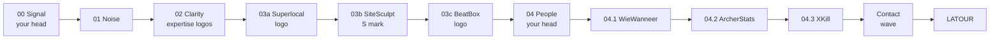

# platour.net: 3D scrollytelling build and flow

**Status: working locally.** Not committed, not deployed.

| | |
| --- | --- |
| Folder | `/Users/latour/Documents/Dev/portfolio-webgpu` (git worktree of `portfolio-26`) |
| Branch | `feat/webgpu-story`, based on `main` |
| Untouched | `feat/xray-concept` and its uncommitted work |
| Deploy | None. A Cloudflare preview only when asked, never production by default |

## 1. Concept: "Signal"

One cloud of particles, re-organised by scroll. It starts as your scanned head, breaks into noise, resolves into order, becomes each project's own mark, returns to you, and settles into the contact section.

The interface stays `#121212` with the `#FF7A00` accent, Clash Display, Satoshi and JetBrains Mono. Each project's particles take that project's colour.

## 2. Scroll flow



| Chapter | Particles | Colour | Motion | Text |
| --- | --- | --- | --- | --- |
| Signal | `PepijnPCD.pcd` | Orange | Assembles on load, scan line | Name, role, tagline, readout |
| Noise | Storm | Orange | Turbulence | Less friction. More signal. |
| Clarity | Twelve scattered expertise logos | SVG colours | Gentle turn | Input / process / output |
| Superlocal | Cut-out letter logo | Blue | Ripple | Project card with live link |
| SiteSculpt | "S" mark from `SiteSculpt.png` | Green | Slow turn | Project card |
| BeatBox Soundlab | Logo from Figma (`BeatBox.svg`, the simple black variant: soundwave, line and wordmark) | Red and cream | Slow turn | Project card, no link |
| People | Your head | Orange | Slow turn | The best interface leaves room for people. |
| WieWanneer | App icon from `WieWanneer.svg` | Lavender | Slow turn | App card with two links |
| ArcherStats | Target and arrow from `ArcherStats.svg` | Green | Slow turn | App card with link |
| XKill | Logo supplied by you (`XKill.png`) | Red and white | Slow turn | Flutter game, Fontys duo case; no link |
| Contact | Wave | Orange | Calm | Contact form |
| Footer | `LATOUR` | Orange | Still | Social links |

The cloud never rotates with the cursor. It sways on its own, and particles near the pointer are pushed aside.

## 3. Assets

All shapes are built in the browser from files already in the repo, so no 3D model files are needed.

- **Superlocal:** `src/gl/shapes.ts` redraws the logo. Save the original as `public/images/superlocal-logo.png` (blue tiles, white or transparent background) and it is used instead.
- **Expertise:** The first four SVGs came from the supplied files. Next.js, React, Tailwind CSS, Figma, Blender, Claude and Bun came from [Simple Icons](https://github.com/simple-icons/simple-icons); Adobe Creative Cloud came from [Simple Icons 13.14.0](https://cdn.jsdelivr.net/npm/simple-icons@13.14.0/icons/adobecreativecloud.svg). Single-colour SVGs were tinted for the dark background.

## Project cards

Copy and links live in `src/story/content.ts`. Facts come from each project's own site or repository:

| Project | Links | Source of the facts |
| --- | --- | --- |
| Superlocal | superlocal.discount, crawlers.superlocal.discount | Both sites (counts as read on 24 Nov 2026) |
| SiteSculpt | lifeoflight.nl | `FiliePepijn/SiteSculpt` source. sitesculpt.net showed Cloudflare error 1000, so it is not linked |
| BeatBox Soundlab | none yet | Your description and the Figma file. The Figma link is not on the page because its sharing setting is unknown |

WieWanneer (wiewanneer.com, app.wiewanneer.com) and ArcherStats (archery.platour.net) come from their local repos. Both repos are private, so no source links. ArcherStats' README still describes an older NestJS backend; the card follows the current code.

## 4. Architecture

```text
src/
  App.tsx                      HTML chapters and layout
  story/
    chapters.ts                chapter list: shape, pose, mood, colour
    content.ts                 project and social copy
    scroll.ts                  GSAP ScrollTrigger → one chapter position
    useChapterScroll.ts        ScrollTrigger copy reveals and active chapter
  gl/
    StoryCanvas.tsx            one fixed canvas, lazy-loads the engine
    engine.ts                  renderer, camera, render loop
    particles.ts               TSL compute passes and sprite material
    shapes.ts                  head, logos and procedural point targets
    post.ts                    bloom, aberration, vignette, grain
```

- **Three.js 0.184** through `three/webgpu` and `three/tsl`. No GLSL.
- **GSAP ScrollTrigger** scrubs one tween per gap between chapters.
- **Particles:** 140,000 on WebGPU, 70,000 on WebGL2, 45,000 on narrow screens. One compute pass per pair of neighbouring chapters.

## 5. Fallbacks and accessibility

| Case | Behaviour |
| --- | --- |
| No WebGPU | Same code on the WebGL2 backend |
| No GPU | Static gradient, content readable |
| Narrow screens | Fewer particles, shape above the text |
| Reduced motion | Shapes follow the scroll without noise or sway |
| Screen readers | Canvas is `aria-hidden`; text is normal HTML |

## 6. Run and test

```bash
cd /Users/latour/Documents/Dev/portfolio-webgpu
```

```bash
bun run dev
```

```bash
bun run build
```

Test flags: `?webgl` forces the fallback. In dev only, `?still` forces the reduced-motion engine path and `window.__story.capture(chapter)` returns a rendered frame.

## 7. Changed compared with the current site

- The project carousel and full-screen project modal are replaced by one chapter per project.
- The R3F hero head is replaced by the particle head (the old component is still used for the social image).
- `wrangler.jsonc` gains the `ASSETS` binding, without which the worker crashes.

## 8. Open questions

- The live platour.net did not open from here, so content comes from the local repo and was not compared.
- **Location:** the page says Helmond; the meta tags say Amsterdam. The page uses Helmond.
- **Title:** the page says "UX/UI Designer & Web-Developer"; the meta tags say "Full Stack Developer & Creative Technologist".
- Chapter copy for Noise and People comes from the uncommitted `feat/xray-concept` work. "Complexity in. Clarity out." is new.

## 9. Checklist

- [x] Particle engine, scroll flow and chapters
- [x] Project marks and post-processing
- [x] Type check, lint and production build
- [x] Rendered check: WebGPU and WebGL2 (frames captured per chapter), real scrolling on desktop and phone width
- [x] About 120 fps at the top of the page in the desktop preview pane
- [ ] Frame rate across all chapters and on a real phone
- [ ] Reduced motion with the system setting (only the engine path was tested, via `?still`)
- [ ] Contact form send (not submitted during testing)
